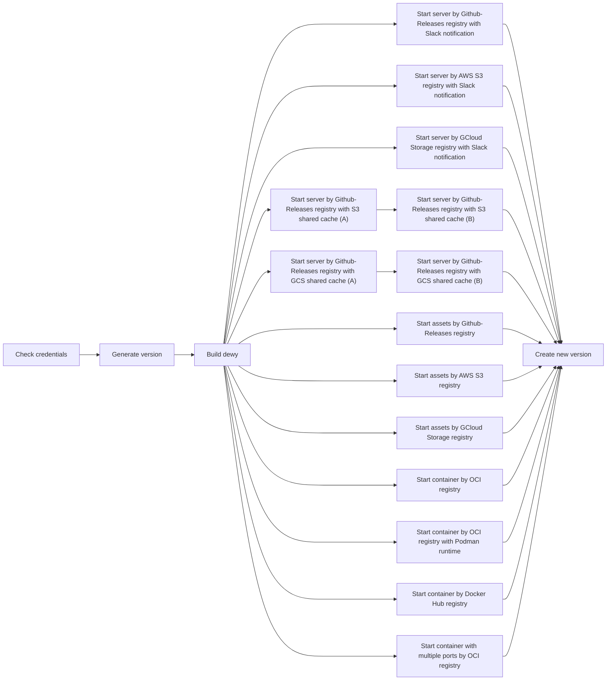
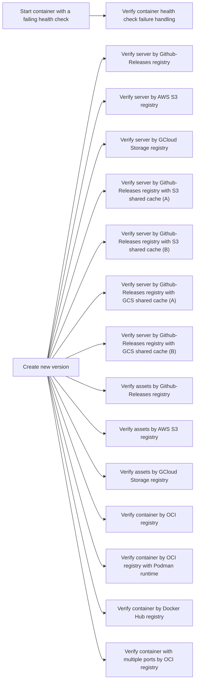
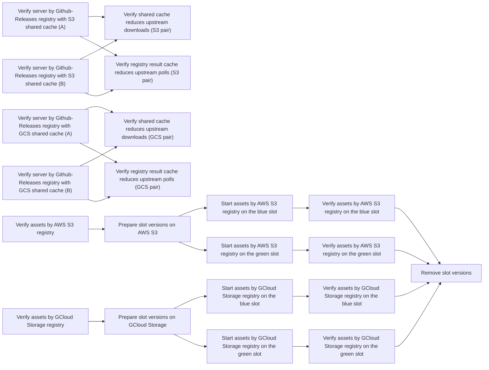

#  

Dewy's end-to-end (E2E) tests run real Dewy processes against real registries and check every deployment mode. The tests are defined in `e2e/test.yml` and run by [Probe](https://github.com/linyows/probe), a declarative workflow tool.

## Testing Approach

Each run follows the same path as a real release:

1. Build Dewy from the commit under test.
2. Start Dewy instances, each of which deploys the latest existing version of the test application, [linyows/dewy-testapp](https://github.com/linyows/dewy-testapp).
3. Publish a new version of the test application.
4. Check that every instance detected and deployed the new version, and that its log has no errors.

## Test Coverage

| Command | Registry | What is tested |
|---|---|---|
| `server` | GitHub Releases (`ghr`) | Process management with symlink-based deployment, Slack notification, and `/metrics` |
| `server` | AWS S3 (`s3`) | Same as above, sourced from S3 |
| `server` | Google Cloud Storage (`gs`) | Same as above, sourced from GCS |
| `server` | GitHub Releases + S3 shared cache | Two instances on the same S3 cache prefix with `registry-ttl` |
| `server` | GitHub Releases + GCS shared cache | Same as above for the GCS cache backend |
| `assets` | GitHub Releases (`ghr`) | Static asset download and symlink management |
| `assets` | AWS S3 (`s3`) | Same as above, sourced from S3 |
| `assets` | Google Cloud Storage (`gs`) | Same as above, sourced from GCS |
| `assets` (slot) | AWS S3 (`s3`) | Two instances with `--slot blue` and `--slot green` on versions that differ only in build metadata |
| `assets` (slot) | Google Cloud Storage (`gs`) | Same as above, sourced from GCS |
| `container` | OCI / ghcr.io (`img`) | Container deployment with 3 replicas, `/metrics`, and `--drain-time` |
| `container` | OCI / ghcr.io with Podman | Same deployment with `--runtime podman` |
| `container` | Docker Hub (`img`) | Same deployment, sourced from Docker Hub |
| `container` (multi-port) | OCI / ghcr.io (`img`) | 2 replicas behind 2 port mappings with the TCP proxy |
| `container` (health check failure) | OCI / ghcr.io (`img`) | A health check that never passes, `--health-timeout`, and rollback of the failed replica |

## Test Flow

The diagrams in this page show one phase each, with each job as one node. They are printed by `e2e/dag.sh`, which collapses the steps of the full job graph from Probe:

```bash
e2e/dag.sh start     # Phase 0 to 2
e2e/dag.sh verify    # Phase 3
e2e/dag.sh followup  # Phase 4 to 6
```

The full graph with every step is in [`e2e/README.md`](https://github.com/linyows/dewy/blob/main/e2e/README.md#architecture), printed by `probe dag --mermaid e2e/test.yml`. After changing `e2e/test.yml`, run these commands again and replace the diagrams.

## Test Structure

The jobs in `e2e/test.yml` run in the following phases. Jobs within a phase run in parallel unless noted.

### Phase 0: Setup

Phase 0 to 2 run the following jobs.




- **Check credentials**: `GITHUB_TOKEN`, `AWS_ACCESS_KEY_ID`, `AWS_SECRET_ACCESS_KEY`, `GOOGLE_APPLICATION_CREDENTIALS` and `SLACK_TOKEN` must be set.
- **Generate version**: the version to publish in Phase 2 is `v3.0.0-<unix time>`, unique per run.
- **Build dewy**: one binary is built per variant into its working directory:

```yaml
- name: Go build for {{ vars.command }}-{{ vars.variant }}
  uses: shell
  with:
    cmd: go build -o ./e2e/{{ vars.command }}/{{ vars.variant }}/dewy ./cmd/dewy
  test: status == 0
  iteration:
  - { command: 'server', variant: 'ghr' }
  - { command: 'server', variant: 's3' }
  # ... one entry per variant
```

### Phase 1: Initial deployment

Each variant starts Dewy as a background process with the shell action. The step returns once the log contains the text set in `ready.log` (for example `Create symlink`), which marks the initial deployment, and fails if that does not happen within `with.timeout`.

In each shared-cache pair, instance B starts after instance A has deployed, so B's first poll reads what A put in the shared cache.

### Phase 2: Publish a new version

After all instances except the health check failure variant have deployed, a release with the version from Phase 0 is created on `linyows/dewy-testapp`:

```yaml
- name: Create release
  uses: shell
  with:
    cmd: |
      gh release create {{ outputs.genver.version }} \
        --repo linyows/dewy-testapp \
        --title {{ outputs.genver.version }} \
        --notes "End-to-end Testing by Probe"
  test: status == 0
```

The next step retries `gh release view` until the release is visible.

### Phase 3: Verification

Phase 3 runs the following jobs.




Each variant has a verify job that runs a shared job definition from `e2e/jobs/` with the `embedded` action, passing the instance's PID, log path and the new version:

| Job definition | Used by |
|---|---|
| `server-verify.yml` | `server` variants |
| `assets-verify.yml` | `assets` variants |
| `container-verify.yml` | `container` variants on ghcr.io, Podman and Docker Hub |
| `container-multiport-verify.yml` | `container` (multi-port) |
| `container-healthfail-verify.yml` | `container` (health check failure) |
| `assets-slot-verify.yml` | `assets` (slot), in Phase 6 |

The health check failure variant does not wait for Phase 2. Its deployment fails on the first version, so its verify job runs after its own start job.

### Phase 4 and 5: Shared cache

Phase 4 to 6 run the following jobs.




After both instances of a shared-cache pair are verified, two jobs count log lines across the pair:

- **Upstream downloads**: an instance logs `Cached artifact` only when it downloads from the registry and writes to the cache. Without sharing, the pair logs it 4 times (2 instances × 2 versions). The test allows at most 3; the ideal is 2.
- **Upstream polls**: an instance logs `Registry result refreshed from upstream` only when it takes the refresh lock and calls the registry. Without the registry-result cache, the pair calls the registry on every poll, about 36 to 60 times in a run. The test expects between 1 and 20.

### Phase 6: Blue/green slots

After the S3 and GCS assets variants are verified, the new version is copied in the same bucket to `slot-e2e/<version>/v1.0.0+blue/` and `slot-e2e/<version>/v1.0.0+green/`. One instance per slot watches that prefix. The two versions differ only in build metadata, so a registry that picks the latest version before checking the slot gives both instances the same one.

The slot versions are copied in the bucket rather than released from `dewy-testapp`, because the other instances would deploy a `+` tag as a new version, and a `+` tag is not a valid container image tag. The last job removes the copies, and runs even when a slot job failed.

## Verification Details

**`server` and `assets`:**

- The new version appears in the log.
- The log has no errors.
- Two symlinks were created, for the initial and the new version.
- Two versions were started or downloaded.
- The variant that runs with `--telemetry` exposes `dewy_deployments_total{command="server"}` and `dewy_server_restarts_total{reason="deploy"}` on `/metrics`.

**`container`:**

- The log has no errors.
- Three containers were created for the initial version and three for the new version.
- Containers do not run as root.
- The ghcr.io variant exposes the `dewy_container_*` series on `/metrics`, waits for the configured `--drain-time` when replacing old containers, and keeps a fixed stop window on shutdown.

**`container` (multi-port):**

- A TCP proxy started on each mapped port, with a backend for each replica.
- An HTTP request to each port succeeds.
- Containers do not run as root, and the log has no errors.

**`container` (health check failure):**

- The health check probes a container port that nothing listens on, so it never passes.
- The failure message carries the `--health-timeout` value, which shows the flag bounds the probe.
- The failed replica is rolled back, and the deployment is never reported as successful.

**`assets` (slot):**

- Each instance deploys once with no errors.
- Each slot directory holds exactly one audit file (`shipped_to_...`). An instance that deployed the other slot's version would leave two files in that directory and none in its own.

## Running the Tests

The GitHub Actions workflow `e2e-test.yml` runs the tests:

- on a push to `main` that changes Go code, `go.mod` or `go.sum`
- on a pull request, when a maintainer comments `/e2e`
- manually from the Actions tab

All runs share one concurrency group and run one at a time, because every run publishes releases to the same test repository.
