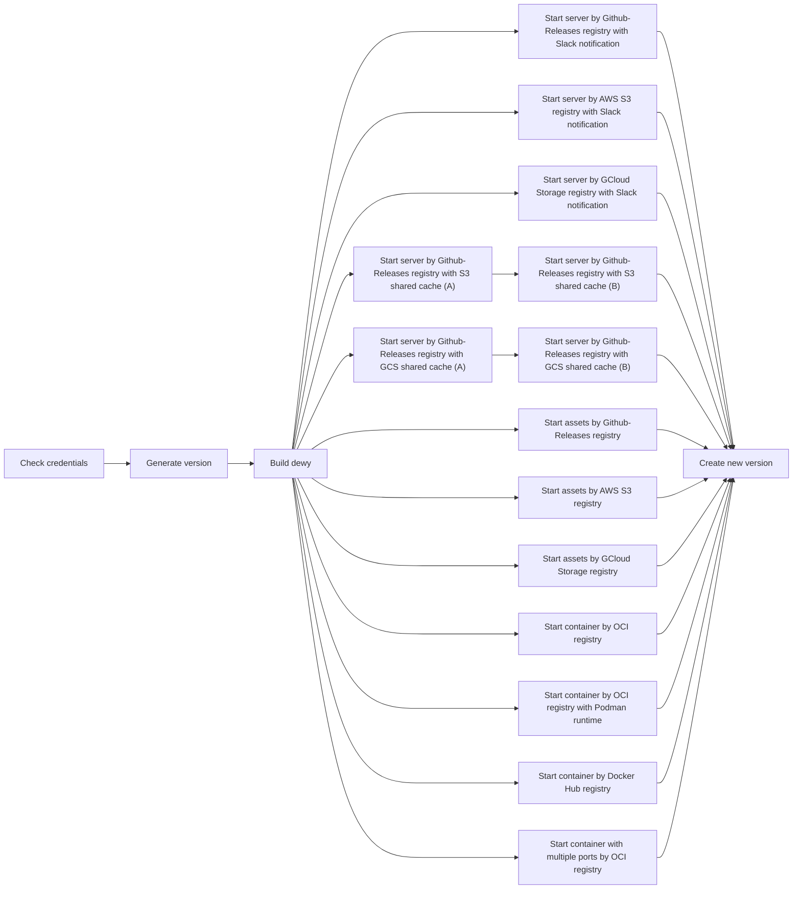
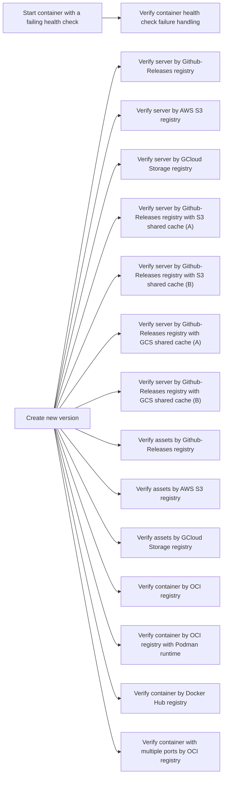
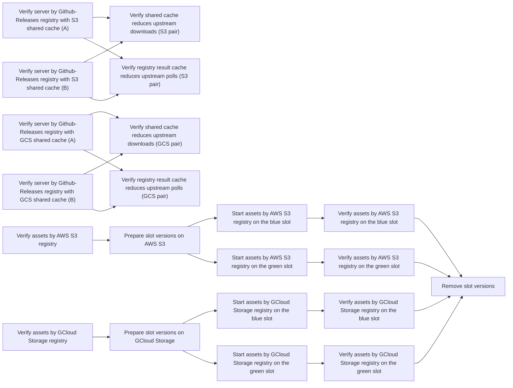

#  

DewyのE2Eテストは、実際のDewyプロセスを実際のレジストリに対して動かし、すべてのデプロイモードを検証します。
テストは`e2e/test.yml`に定義し、宣言的ワークフローツールの[Probe](https://github.com/linyows/probe)で実行します。

## テストの進め方

各実行は、実際のリリースと同じ順序で進みます。

1. テスト対象のコミットからDewyをビルドする。
2. Dewyのインスタンスを起動し、テスト用アプリケーション[linyows/dewy-testapp](https://github.com/linyows/dewy-testapp)の既存の最新バージョンをデプロイさせる。
3. テスト用アプリケーションの新しいバージョンを公開する。
4. すべてのインスタンスが新しいバージョンを検出してデプロイしたことと、ログにエラーがないことを確認する。

## テストの対象

| コマンド | レジストリ | 検証する内容 |
|---|---|---|
| `server` | GitHub Releases（`ghr`） | シンボリックリンクによるデプロイとプロセス管理、Slack通知、`/metrics` |
| `server` | AWS S3（`s3`） | 同上（S3から取得） |
| `server` | Google Cloud Storage（`gs`） | 同上（GCSから取得） |
| `server` | GitHub Releases + S3共有キャッシュ | 同じS3キャッシュプレフィックスを`registry-ttl`付きで使う2インスタンス |
| `server` | GitHub Releases + GCS共有キャッシュ | 同上（GCSキャッシュバックエンド） |
| `assets` | GitHub Releases（`ghr`） | 静的アセットのダウンロードとシンボリックリンク管理 |
| `assets` | AWS S3（`s3`） | 同上（S3から取得） |
| `assets` | Google Cloud Storage（`gs`） | 同上（GCSから取得） |
| `assets`（slot） | AWS S3（`s3`） | ビルドメタデータだけが異なるバージョンを、`--slot blue`と`--slot green`の2インスタンスで扱う |
| `assets`（slot） | Google Cloud Storage（`gs`） | 同上（GCSから取得） |
| `container` | OCI / ghcr.io（`img`） | 3レプリカのコンテナデプロイ、`/metrics`、`--drain-time` |
| `container` | OCI / ghcr.io（Podman） | 同じデプロイを`--runtime podman`で実行 |
| `container` | Docker Hub（`img`） | 同じデプロイ（Docker Hubから取得） |
| `container`（マルチポート） | OCI / ghcr.io（`img`） | 2つのポートマッピングとTCPプロキシの後ろに置いた2レプリカ |
| `container`（ヘルスチェック失敗） | OCI / ghcr.io（`img`） | 通らないヘルスチェック、`--health-timeout`、失敗したレプリカのロールバック |

## テストの流れ

このページの図は、ジョブを1つのノードにまとめ、フェーズごとに分けて示します。
図は`e2e/dag`コマンドで出力します。
このコマンドは、Probeが出力するジョブの依存関係からステップを省きます。

```bash
go run ./e2e/dag start     # フェーズ0〜2
go run ./e2e/dag verify    # フェーズ3
go run ./e2e/dag followup  # フェーズ4〜6
```

ステップまで含む全体の図は、[`e2e/README.md`](https://github.com/linyows/dewy/blob/main/e2e/README.md#architecture)にあります（`probe dag --mermaid e2e/test.yml`の出力）。
`e2e/test.yml`を変更したら、これらのコマンドを実行し直して図を差し替えてください。

## テストの構成

`e2e/test.yml`のジョブは、次のフェーズの順に実行します。
特に記載がない限り、同じフェーズのジョブは並列に実行します。

### フェーズ0：準備

フェーズ0〜2では、次のジョブを実行します。




- **認証情報の確認**：`GITHUB_TOKEN`、`AWS_ACCESS_KEY_ID`、`AWS_SECRET_ACCESS_KEY`、`GOOGLE_APPLICATION_CREDENTIALS`、`SLACK_TOKEN`が設定されていることを確認します。
- **バージョンの生成**：フェーズ2で公開するバージョンを`v3.0.0-<UNIX時刻>`とし、実行ごとに一意にします。
- **Dewyのビルド**：バリアントごとに1つのバイナリを、その作業ディレクトリにビルドします。

```yaml
- name: Go build for {{ vars.command }}-{{ vars.variant }}
  uses: shell
  with:
    cmd: go build -o ./e2e/{{ vars.command }}/{{ vars.variant }}/dewy ./cmd/dewy
  test: status == 0
  iteration:
  - { command: 'server', variant: 'ghr' }
  - { command: 'server', variant: 's3' }
  # ... バリアントごとに1行
```

### フェーズ1：初回デプロイ

各バリアントは、shellアクションでDewyをバックグラウンドプロセスとして起動します。
ステップは、`ready.log`に指定した文字列（`Create symlink`など）がログに出た時点で終わります。
この文字列は初回デプロイの完了を示します。
`with.timeout`以内に出なければ、ステップは失敗します。

共有キャッシュのペアでは、インスタンスBはインスタンスAのデプロイが終わってから起動します。
そのため、Bの最初のポーリングは、Aが共有キャッシュに書いた内容を読みます。

### フェーズ2：新しいバージョンの公開

ヘルスチェック失敗のバリアントを除くすべてのインスタンスがデプロイを終えたら、フェーズ0のバージョンで`linyows/dewy-testapp`にリリースを作ります。

```yaml
- name: Create release
  uses: shell
  with:
    cmd: |
      gh release create {{ outputs.genver.version }} \
        --repo linyows/dewy-testapp \
        --title {{ outputs.genver.version }} \
        --notes "End-to-end Testing by Probe"
  test: status == 0
```

次のステップで、リリースを取得できるまで`gh release view`を再試行します。

### フェーズ3：検証

フェーズ3では、次のジョブを実行します。




各バリアントの検証ジョブは、`e2e/jobs/`の共通ジョブ定義を`embedded`アクションで実行します。
引数として、インスタンスのPID、ログのパス、新しいバージョンを渡します。

| ジョブ定義 | 使うバリアント |
|---|---|
| `server-verify.yml` | `server`の各バリアント |
| `assets-verify.yml` | `assets`の各バリアント |
| `container-verify.yml` | ghcr.io、Podman、Docker Hubの`container` |
| `container-multiport-verify.yml` | `container`（マルチポート） |
| `container-healthfail-verify.yml` | `container`（ヘルスチェック失敗） |
| `assets-slot-verify.yml` | `assets`（slot）、フェーズ6で使用 |

ヘルスチェック失敗のバリアントは、フェーズ2を待ちません。
最初のバージョンでデプロイが失敗するので、検証ジョブは自身の起動ジョブの後に実行します。

### フェーズ4と5：共有キャッシュ

フェーズ4〜6では、次のジョブを実行します。




共有キャッシュのペアは、両方のインスタンスの検証が終わった後、ペア全体のログの行数を数えます。

- **上流からのダウンロード**：インスタンスが`Cached artifact`をログに出すのは、レジストリからダウンロードしてキャッシュに書いたときだけです。共有しなければ、ペアで4回（2インスタンス × 2バージョン）出ます。テストでは3回以下を許容し、理想は2回です。
- **上流へのポーリング**：インスタンスが`Registry result refreshed from upstream`をログに出すのは、更新用のロックを取ってレジストリを呼んだときだけです。レジストリ結果のキャッシュがなければ、ペアはポーリングのたびにレジストリを呼び、1回の実行で36〜60回ほどになります。テストでは1回以上20回以下を期待します。

### フェーズ6：blue/greenスロット

S3とGCSの`assets`バリアントの検証が終わったら、新しいバージョンを同じバケットの`slot-e2e/<version>/v1.0.0+blue/`と`slot-e2e/<version>/v1.0.0+green/`にコピーします。
このプレフィックスを、スロットごとに1つのインスタンスが参照します。
2つのバージョンはビルドメタデータだけが異なります。
そのため、スロットを確認する前に最新バージョンを選ぶレジストリは、両方のインスタンスに同じバージョンを渡してしまいます。

スロット用のバージョンは、`dewy-testapp`のリリースとしてではなく、バケット内のコピーとして用意します。
`+`を含むタグをリリースすると、ほかのインスタンスがそれを新しいバージョンとしてデプロイしてしまい、またコンテナイメージのタグとしても使えないためです。
最後のジョブがコピーを削除します。
このジョブは、スロットのジョブが失敗しても実行します。

## 検証の内容

**`server`と`assets`：**

- 新しいバージョンがログに出る。
- ログにエラーがない。
- シンボリックリンクが2回（初回と新バージョン）作られる。
- 2つのバージョンが起動またはダウンロードされる。
- `--telemetry`付きで起動したバリアントでは、`/metrics`が`dewy_deployments_total{command="server"}`と`dewy_server_restarts_total{reason="deploy"}`を出力する。

**`container`：**

- ログにエラーがない。
- 初回バージョンと新バージョンで、それぞれ3つのコンテナが作られる。
- コンテナがrootで動いていない。
- ghcr.ioのバリアントでは、`/metrics`が`dewy_container_*`の系列を出力し、古いコンテナの置き換えで指定した`--drain-time`だけ待ち、停止時は固定の停止待ち時間を使う。

**`container`（マルチポート）：**

- マッピングした各ポートでTCPプロキシが起動し、レプリカごとにバックエンドが登録される。
- 各ポートへのHTTPリクエストが成功する。
- コンテナがrootで動いておらず、ログにエラーがない。

**`container`（ヘルスチェック失敗）：**

- ヘルスチェックは、コンテナ内で何も待ち受けていないポートを確認するので、必ず失敗する。
- 失敗メッセージに`--health-timeout`の値が含まれる。これにより、このフラグが確認の時間を制限していることを確かめる。
- 失敗したレプリカがロールバックされ、デプロイが成功として報告されない。

**`assets`（slot）：**

- 各インスタンスが1回だけ、エラーなくデプロイする。
- 各スロットのディレクトリに、監査ファイル（`shipped_to_...`）がちょうど1つある。もう一方のスロットのバージョンをデプロイしたインスタンスがあれば、そのディレクトリには2つ、自分のディレクトリには0個のファイルが残る。

## テストの実行

GitHub Actionsのワークフロー`e2e-test.yml`が、次のときにテストを実行します。

- Goのコード、`go.mod`、`go.sum`を変更するコミットが`main`にpushされたとき
- プルリクエストでメンテナーが`/e2e`とコメントしたとき
- Actionsタブから手動で実行したとき

すべての実行は1つのconcurrencyグループを共有し、1つずつ実行します。
どの実行も同じテスト用リポジトリにリリースを公開するためです。
